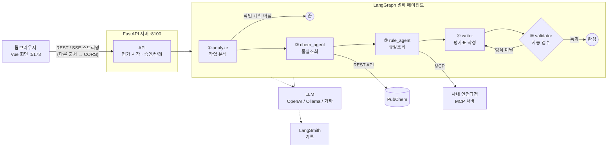
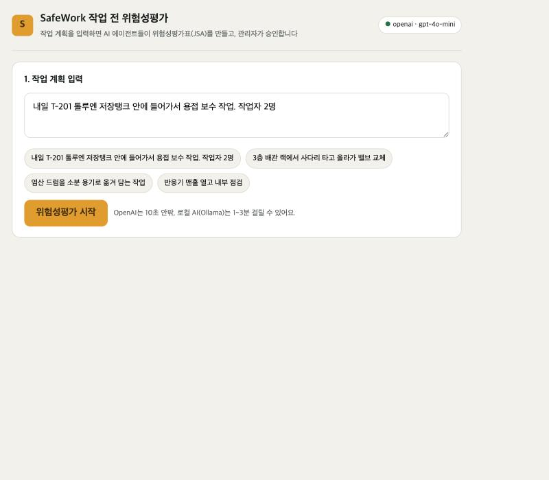
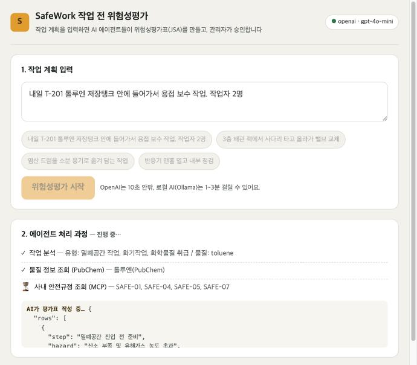
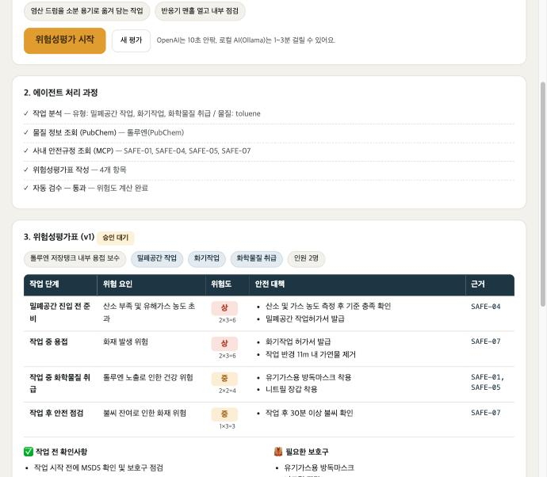
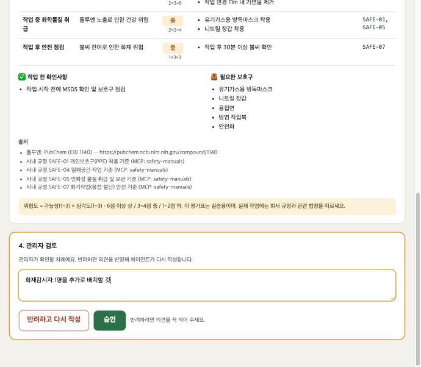
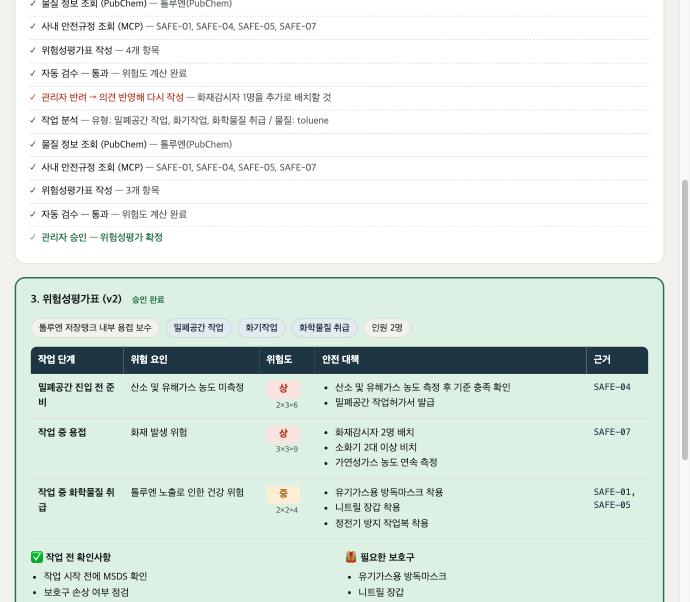

# 🦺 SafeWork — 작업 전 위험성평가 AI 에이전트

> **SKALA 광주 2반 · G041 · 김세빈**
> 최종 프로젝트 보고서

작업 계획을 한 줄 입력하면, AI 에이전트 여러 명이 역할을 나눠 **물질 위험 정보**와 **사내 안전규정**을 찾고,
**근거가 달린 위험성평가표(JSA)** 를 만들어 주는 서비스입니다. 마지막 결정은 **관리자(사람)** 가 승인·반려로 내립니다.

| 입력 | ➜ | 출력 |
|---|---|---|
| "내일 T-201 톨루엔 저장탱크 안에 들어가서 용접 보수 작업. 작업자 2명" | | 작업 단계별 위험 요인 · 위험도(상/중/하) · 안전 대책 · 근거 규정 · 보호구 |

> ⚠️ 사내 안전규정(`data/manuals/`)은 실습용으로 만든 가상 데이터입니다.

---

## 목차
1. [문제 정의 — 왜 만들었나](#1-문제-정의--왜-만들었나)
2. [구현한 핵심 기능](#2-구현한-핵심-기능)
3. [적용 기술](#3-적용-기술)
4. [구현 결과 — 아키텍처와 시연](#4-구현-결과--아키텍처와-시연)
5. [교훈 — 한계, 개선 방향, 소감](#5-교훈--한계-개선-방향-소감)
6. [부록 — 실행 방법](#6-부록--실행-방법)

---

## 1. 문제 정의 — 왜 만들었나

화학 공장에서는 탱크 안 작업, 용접, 높은 곳 작업처럼 위험한 일을 하기 전에 **위험성평가표(JSA)** 를 꼭 작성합니다.
그런데 지금 방식에는 이런 문제가 있습니다.

| 기존 방식의 문제 | 이 프로젝트의 해결 방법 |
|---|---|
| 😩 물질 정보(MSDS)와 사내 규정을 **사람이 일일이 찾아야** 해서 오래 걸림 | 에이전트가 **PubChem**과 **사내 규정 서버(MCP)** 를 자동으로 조회 |
| 📋 예전 양식을 복사해 쓰다 보니 **위험 요인이 빠지기 쉬움** | 작업 유형(밀폐공간·화기·고소·화학물질)을 먼저 분석하고, 유형마다 위험을 하나 이상 넣도록 함 |
| ❓ 대책의 **근거가 불분명** | 모든 대책에 **근거 규정 번호**와 **출처 링크**를 붙임 |
| ⚖️ 위험도 판단이 **사람마다 다름** | 위험도 = 가능성 × 심각도를 **코드가 계산** (AI가 임의로 정하지 않음) |
| 🤖 AI만 믿고 쓰기엔 **위험함** | **관리자가 승인·반려**해야 확정됨. 반려 의견은 자동으로 반영해 다시 작성 |

---

## 2. 구현한 핵심 기능

1. **작업 계획 분석**: 문장에서 작업 유형, 화학물질, 인원을 뽑아냄. 작업 계획이 아닌 입력("점심 메뉴 추천해줘")은 안내 후 종료
2. **물질 위험 정보 조회**: PubChem 공개 API에서 GHS 위험 문구(예: H225 고인화성 액체)를 가져와 한글로 표시. 인터넷이 안 되면 로컬 캐시로 대신함
3. **사내 안전규정 검색**: 직접 만든 **MCP 서버**에서 작업에 맞는 규정(8종 중)을 찾아옴
4. **위험성평가표 자동 작성**: 조사한 내용**만** 근거로 작성하고, 정해진 JSON 형식으로 받아 표로 표시
5. **자동 검수**: 위험도 계산, AI가 지어낸 규정 번호 삭제, 형식이 부족하면 다시 작성시킴
6. **관리자 승인 / 반려**: 반려 의견을 넣으면 v2, v3…로 다시 작성. 승인하면 확정, 인쇄·PDF 저장 가능
7. **실시간 진행 표시**: 에이전트가 일하는 단계와 AI가 글자를 써 내려가는 과정을 화면에 실시간 표시 (SSE 스트리밍)

---

## 3. 적용 기술

### 3-1. 요구 항목별 적용 현황

| 요구 항목 | 적용 | 이 프로젝트에서 한 것 |
|---|:---:|---|
| **Multi-Agent & LangGraph** | ✅ | 역할이 다른 에이전트 5개로 분리 (분석 · 물질조회 · 규정조회 · 작성 · 검수). LangGraph `StateGraph`로 흐름을 그림 |
| ㄴ 동적 재계획 | ✅ | ① 작업 계획이 아니면 바로 종료 (조건부 분기) ② 검수 불합격이면 작성 에이전트로 되돌아가 재작성 ③ 관리자 반려 시 의견을 넣어 다시 실행 |
| ㄴ Supervisor 패턴 | △ | 감독 에이전트가 매번 다음 순서를 정하는 방식 대신, **정해진 흐름 + 조건부 분기**로 단순하게 구성 |
| **MCP** | ✅ | 사내 안전규정 MCP 서버를 직접 만듦 → **Tool** 2개(`search_manuals`, `list_manuals`) + **Resource** 1개(`manual://{id}` 규정 원문) |
| ㄴ Prompt | ❌ | 미적용 (향후 개선) |
| **RAG** | △ | 규정을 **검색해서 AI 지시문에 넣어 주는 것(문서 주입)** 은 적용. 다만 Vector DB 의미 검색이 아니라 **키워드 점수 검색** |
| **모듈화** | ✅ | `agents/`(에이전트) · `tools/`(외부 도구) · `mcp_server/`(MCP 서버) · `frontend/`(화면)로 역할별 분리 |
| **의존성 주입** | ✅ | MCP 연결을 그래프에 넣어 줌 (`build_graph(manual_client)`). 환경변수 `LLM_BACKEND` 하나로 **가짜 LLM / Ollama / OpenAI** 교체 |
| **테스트** | ✅ | 가짜 LLM으로 전체 흐름을 자동 점검하는 테스트 **23개 항목 통과** (인터넷·API 키 없이 실행) |
| **LangSmith 트레이싱** | ✅ | `.env` 설정만으로 에이전트·LLM 호출이 LangSmith에 자동 기록됨 |
| **LLM-as-a-Judge** | ❌ | 미적용. 대신 **코드 검수(validator)** 로 형식·근거를 자동 확인 |

### 3-2. 기타 적용 기술

| 기술 | 어디에 썼나 |
|---|---|
| **FastAPI** | 백엔드 REST API 서버, 서버 시작 시 MCP 연결을 1번만 만드는 `lifespan` |
| **SSE 스트리밍** | 에이전트 진행 단계 + AI가 작성 중인 글자를 실시간 전송 (LangGraph `stream_mode=["updates", "messages"]`) |
| **CORS** | 화면(5173)과 API(8100)가 다른 출처라서 `CORSMiddleware`로 허용 |
| **Pydantic (구조화된 출력)** | AI 답변을 정해진 표 형식(JSON)으로 받아 검사 |
| **외부 REST API** | PubChem (미국 국립보건원 화학물질 DB, 무료) |
| **Vue 3** | 화면 (CDN 방식, 빌드 없음) |

---

## 4. 구현 결과 — 아키텍처와 시연

### 4-1. 전체 구조



### 4-2. 에이전트 역할

| 순서 | 에이전트 | 하는 일 | 사용 도구 |
|:---:|---|---|---|
| ① | **analyze** 작업 분석 | 작업 유형·물질·인원 추출. 놓친 것은 키워드로 한 번 더 확인 | 작은 LLM |
| ② | **chem_agent** 물질조회 | 물질의 위험 문구·신호어 조회 | PubChem API (실패 시 로컬 캐시) |
| ③ | **rule_agent** 규정조회 | 작업 유형별 사내 규정 검색 | MCP 서버 `search_manuals` |
| ④ | **writer** 평가표 작성 | 조사 결과만 근거로 평가표 작성 | 큰 LLM + 구조화된 출력 |
| ⑤ | **validator** 자동 검수 | 위험도 계산, 근거 없는 규정번호 삭제, 형식 검사 | 코드 (AI 아님) |
| - | **관리자** (사람) | 승인 → 확정 / 반려 → 의견 넣고 ①부터 다시 실행 | 화면 버튼 |

**위험도 계산 규칙** (코드가 계산): 가능성(1~3) × 심각도(1~3) → **6점 이상 상 / 3~4점 중 / 1~2점 하**

### 4-3. 시연 시나리오

**시나리오:** "내일 T-201 톨루엔 저장탱크 안에 들어가서 용접 보수 작업. 작업자 2명"
→ 탱크 안(밀폐공간) + 용접(화기작업) + 톨루엔(인화성 물질)이 겹친 **고위험 작업**

#### ① 작업 계획 입력
예시 버튼을 누르거나 직접 입력한 뒤 [위험성평가 시작]을 누릅니다. 오른쪽 위에 사용 중인 AI 모델이 표시됩니다.



#### ② 에이전트가 일하는 과정이 실시간으로 표시됨
작업 분석 → PubChem에서 톨루엔 조회 → MCP 서버에서 규정 4개(SAFE-01·04·05·07) 검색이 차례로 표시됩니다.
아래 회색 상자에는 AI가 평가표를 **글자 단위로 써 내려가는 모습**이 실시간으로 보입니다.



#### ③ 근거가 달린 위험성평가표 완성
- 위험도 `상 2×3=6`은 **코드가 계산**한 값
- 오른쪽 **근거** 칸에 사내 규정 번호가 붙고, 아래 **출처**에 PubChem 링크가 남음



#### ④ 관리자 반려
"화재감시자 1명을 추가로 배치할 것"이라고 적고 [반려하고 다시 작성]을 누릅니다.



#### ⑤ 의견이 반영된 v2 → 승인 완료
반려 의견을 반영해 **v2**가 작성되고(대책에 '화재감시자 배치' 추가), 승인하면 초록색으로 **확정**됩니다.



### 4-4. 테스트 결과

| 점검 | 결과 |
|---|---|
| 자동 점검 (가짜 LLM, 인터넷 없이) | **23 / 23 통과** — 작업 유형 인식, 규정 검색, 위험도 계산, SSE 스트리밍, CORS, 반려→재작성→승인, 잘못된 입력 처리 |
| OpenAI(gpt-4o-mini) 실제 실행 | 평가표 1건 약 **5~10초** |
| PubChem 실제 조회 | 톨루엔·벤젠·염산 정상 조회, 없는 물질은 로컬 캐시로 대체 |
| LangSmith | 실행 기록 저장 확인 |

---

## 5. 교훈 — 한계, 개선 방향, 소감

### 5-1. 한계와 트레이드오프

| 선택한 것 | 얻은 것 | 포기한 것 |
|---|---|---|
| 규정 검색을 **키워드 방식**으로 | 구현이 단순하고 결과를 설명하기 쉬움 | 표현이 달라지면 못 찾음 ("불꽃 작업" ≠ "용접") |
| 에이전트를 **차례대로** 실행 | 흐름이 단순해서 이해·디버깅이 쉬움 | 물질조회·규정조회를 동시에 하면 더 빨라질 수 있음 |
| 반려 시 **처음부터 다시** 실행 | 코드가 단순함 | 이미 조회한 정보를 다시 조회 → 시간·비용 낭비 |
| 평가 기록을 **메모리**에 저장 | 설치할 DB가 없음 | 서버를 끄면 기록이 사라짐 |
| **위험도는 코드**로 계산 | 결과가 일관됨 | 가능성·심각도 점수 자체는 여전히 AI 판단 |
| 발표는 **OpenAI**로 | 품질과 속도가 좋음 | 사용할 때마다 요금이 듦 (로컬 Ollama는 무료지만 느리고 실수가 잦음) |

### 5-2. 향후 개선 사항
- **RAG 도입**: 규정을 Vector DB에 넣고 의미 기반으로 검색
- **MCP Prompt 추가**: 평가표 작성 지시문도 MCP 서버에서 관리
- **LLM-as-a-Judge**: 다른 AI가 평가표의 품질(빠진 위험은 없는지)을 채점
- **병렬 실행**: 물질조회와 규정조회를 동시에 실행
- **DB 저장 + 로그인**: 평가 기록 보관, 작업자/관리자 권한 구분

### 5-3. 수행 소감
- 처음에는 AI 하나에게 "위험성평가표를 써줘"라고 하면 될 줄 알았습니다. 하지만 근거 없는 대책이나 없는 규정 번호를 만들어 내는 경우가 있었습니다.
  **조사하는 에이전트와 쓰는 에이전트를 나누고, 코드로 검수하고, 마지막은 사람이 승인하는 구조**를 만들면서 왜 멀티 에이전트를 쓰는지 직접 이해할 수 있었습니다.
- 수업에서 배운 LangGraph, MCP, FastAPI, SSE, LangSmith를 실제 문제 하나에 모두 연결해 보면서, 각각의 기술이 서비스에서 어떤 역할을 하는지 감을 잡을 수 있었습니다.
- 안전처럼 실수가 큰 분야일수록 **AI가 모든 것을 결정하지 않게 하는 설계**가 중요하다는 것을 느꼈습니다.

---

## 6. 부록 — 실행 방법

### 폴더 구조
```
safework_agent/
├── server.py                  # FastAPI 서버 — REST API, SSE 스트리밍, CORS, 승인/반려
├── agents/
│   ├── graph.py               # ⭐ LangGraph 멀티 에이전트 흐름
│   ├── prompts.py             # 에이전트 지시문, 작업 유형 키워드, 위험도 계산
│   ├── schemas.py             # 구조화된 출력의 틀 (Pydantic)
│   ├── llm.py                 # LLM_BACKEND로 ollama/openai/fake 선택
│   └── fake_llm.py            # 테스트용 가짜 LLM
├── tools/
│   ├── pubchem.py             # 도구 ① PubChem REST API
│   ├── manual_client.py       # 도구 ② MCP 서버 연결
│   └── ghs_ko.py              # GHS 위험문구 한글표
├── mcp_server/safety_server.py  # 직접 만든 MCP 서버 (Tool 2개 + Resource 1개)
├── data/
│   ├── manuals/*.md           # 사내 안전규정 8종 (실습용 가상)
│   └── chemicals_local.json   # PubChem 접속 실패 시 쓰는 로컬 캐시 10종
├── frontend/index.html        # Vue 3 화면
├── sh/                        # 실행 스크립트
├── tests/test_smoke.py        # 자동 점검
└── docs/images/               # 보고서 화면 캡처
```

### 실행 (macOS)
```bash
# 0) 처음 한 번 — 가상환경 + 패키지 설치 + .env 생성
bash sh/setup.sh

# 1) 백엔드 켜기 — 셋 중 하나
bash sh/run_backend.sh fake      # AI 없이 연결만 확인
bash sh/run_backend.sh ollama    # 로컬 AI (무료)
bash sh/run_backend.sh openai    # OpenAI (과금, .env에 키 필요)

# 2) 새 터미널 탭에서 화면 켜기 → 브라우저 http://localhost:5173
bash sh/run_frontend.sh
```

- API 문서: http://localhost:8100/docs
- 자동 점검: `LLM_BACKEND=fake PUBCHEM_OFFLINE=1 .venv/bin/python3 -m tests.test_smoke`
- 도구만 시험: `bash sh/test_tools.sh benzene`

### API

| 메서드 | 주소 | 설명 |
|---|---|---|
| GET | `/health` | 서버 상태, 사용 중인 LLM |
| GET | `/manuals` | 사내 안전규정 목록 (MCP 경유) |
| POST | `/jsa` | `{"request": "작업 계획"}` → 평가표 (승인 대기) |
| POST | `/jsa/{job_id}/review` | `{"approved": false, "comment": "..."}` → 반려(다시 작성) / 승인(확정) |
| GET | `/jsa/stream?request=...` | 평가 시작 — SSE 스트리밍 |
| GET | `/jsa/{job_id}/revise/stream?comment=...` | 반려 후 다시 작성 — SSE 스트리밍 |
| GET | `/jsa/{job_id}` | 현재 상태 |

SSE 이벤트 순서: `start` → `step`(단계 완료) → `token`(작성 중인 글자) → `result`(평가표) → `[DONE]`

### 환경변수 (`.env`)

| 이름 | 기본값 / 설명 |
|---|---|
| `LLM_BACKEND` | `ollama` (`openai`, `fake`) |
| `OPENAI_API_KEY` | OpenAI 사용 시 필요 |
| `OPENAI_ANALYZER_MODEL` / `OPENAI_WRITER_MODEL` | `gpt-4o-mini` |
| `OLLAMA_ANALYZER_MODEL` / `OLLAMA_WRITER_MODEL` | `qwen3:0.6b` / `qwen3:8b` |
| `LANGCHAIN_TRACING_V2` + `LANGCHAIN_API_KEY` | LangSmith 기록 켜기 |
| `PUBCHEM_OFFLINE` | `1`이면 로컬 캐시만 사용 |
| `DISABLE_CORS` | `1`이면 CORS를 끔 → 브라우저 콘솔에서 CORS 에러 확인 실험 |
